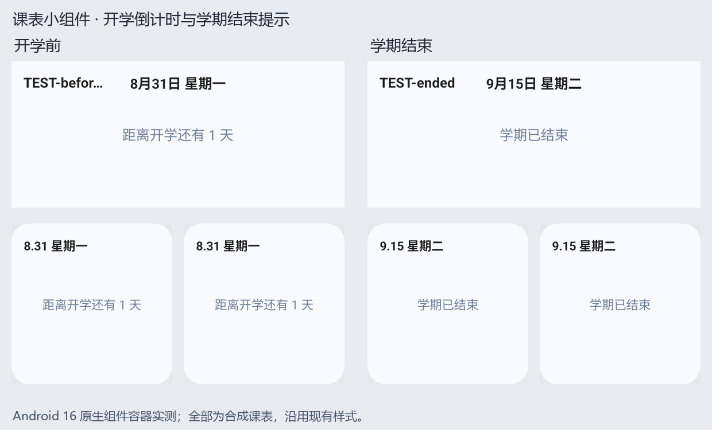

# Android 课表小组件

本文说明 Android 课表小组件的数据来源、渲染方式、刷新时机和测试方法。小组件由 Android 原生 AppWidget 实现，Web 页面不负责绘制桌面上的小组件。

## 组成

原生实现位于 `android/app/src/main/java/com/manual/univ/widget/`：

| 类 | 职责 |
| --- | --- |
| `CourseWidgetPlugin` | 暴露 Capacitor `CourseWidget` 插件方法，接收课表和外观同步请求 |
| `BarWidgetProvider` / `CardWidgetProvider` / `CompactBarWidgetProvider` / `CompactCardWidgetProvider` | 接收 AppWidget 生命周期及日期、时间、时区、配置和精确闹钟权限变化广播，分发对应样式的刷新 |
| `CourseWidgetStore` | 将课表、课表主题和外观 JSON 保存在 Android `SharedPreferences` |
| `BarWidgetRenderer` / `CardWidgetRenderer` / `CompactBarWidgetRenderer` / `CompactCardWidgetRenderer` | 从本地数据组装四种样式的 `RemoteViews` 并更新已放置的小组件 |
| `CourseWidgetRemoteViews` | 绑定共用标题、状态、点击事件和可滚动列表，并按系统版本选择列表数据通道 |
| `CourseWidgetRefresh` | 统一安排 `RTC_WAKEUP` 刷新闹钟、查询精确闹钟权限并处理权限变化 |
| `CourseWidgetRemoteViewsService` / `CourseWidgetListFactory` | 为 Android 8–11 的组件提供 service-backed 可滚动课程列表 |
| `CourseWidgetCourseManager` | 选择当天课程、读取课程信息和颜色，并填充课程卡片 |
| `CourseWidgetSemester` | 按本地日历日期解析学期状态、当前周与开学倒计时 |
| `CourseWidgetTimeResolver` | 按时间表预设解析课程起止时间，并判断课程是否已结束 |
| `CourseWidgetAppearance` / `CourseWidgetColorUtils` | 解析小组件浅色、深色及用户指定的调色板 |

`MainActivity` 只注册 `CourseWidgetPlugin`。Provider、刷新广播和兼容服务位于 `AndroidManifest.xml`，各样式初始布局和尺寸位于 `res/xml/*_widget_info.xml`。

## 数据流

1. Web 层的 `src/platform/capacitor/courseWidgetSchedule.ts` 读取当前课表和对应主题，通过 Capacitor 插件发送给 Android。
2. 应用存储初始化时开始监听课表库变更，并立即同步一次；课表库变化、进入 `/courses` 页面和保存学期起始日期时也会触发同步。
3. 插件将数据写入名为 `CapacitorStorage` 的 SharedPreferences，再请求 Provider 刷新小组件。课表和外观数据都保存在设备本地，不依赖网络服务。
4. 外观同步会将当前主题模式及浅色、深色调色板一并传入；Provider 渲染时按所选模式应用调色板，系统模式则跟随资源的日夜主题。

学期起始日期随当前课表 JSON 一起同步，Android 据此计算当前周。小组件根据系统本地日期选择星期和当天课程。

## 学期状态

四种样式共用学期状态判断，口径与课程页一致：优先读取当前课表的 `semesterStartDate`，缺失时回退到 `scheduleData.table.startDate`；从该日期起每 7 天算一周，最大周数至少为 1，不将非周一起始日期改为周一。

| 状态 | 小组件显示 |
| --- | --- |
| 尚无课表数据 | 保留“数据未加载，请先打开应用进行初始化”提示 |
| 起始日期缺失或无效 | 提示“请在应用中检查学期起始日期” |
| 起始日期之前 | 显示“距离开学还有 X 天”，按本地日历日计算 |
| 第 1 周至最大周数 | 显示当前周、当天课程或原有的今日无课/课程已结束状态 |
| 超过最大周数 | 显示“学期已结束” |

学期之外隐藏周次、课程列表和剩余课程数，避免未开学显示第 1 周或结束后周数继续递增。一次渲染从同一个时间快照取得本地日期、周次和课程结束判断；日历日差不按本地时间的 24 小时长度计算，避免夏令时产生偏差。

非上课状态沿用次日 `00:00:05` 的刷新安排；课表同步、修改学期设置、系统日期或时区变化也会重新计算。Android 的 `Intent.ACTION_TIME_CHANGED` 对应实际广播名称 `android.intent.action.TIME_SET`，Manifest 必须监听后者。

下面为合成课表在原生组件容器中的显示示例，沿用现有的状态文字样式：



## 时间表和课程显示

原生时间解析与应用时间表预设保持一致：

- `universityTown` 和 `international` 使用大学城 / 国际时间；
- `wushan` 使用五山时间；
- 其他预设（包括 `builtIn`）使用课表 `scheduleData.timeSlots`，优先匹配课表的 `timeTable`，没有匹配项时使用该节次的首个时间项；
- 如果没有可用的时间表时间，则回退到课程自身的起止时间。

当天课程先按星期、周次和单双周规则筛选，再按开始节次排序。小组件显示当天全部尚未结束的课程，课程区域可垂直滚动。课程时间精确到分钟：系统本地时间严格晚于当天的结束时刻才会隐藏该课程；在结束时刻的整分仍显示。

- 今天没有排课：隐藏课程列表，在组件中央显示“今日无课”。
- 今天有课且仍有未结束课程：显示可滚动课程列表；宽样式在启用剩余课程显示时，于底部显示剩余课程数。
- 今天有课但全部结束：隐藏课程列表，在组件中央显示“今日课程已结束”。

## 列表兼容机制

四种样式共用 `CourseWidgetRemoteViews` 和 `CourseWidgetListFactory.createItemView()`，课程名称、地点、时间、颜色和点击行为保持一致。列表数据通道按系统版本切换：

- Android 12（API 31）及以上：使用 `RemoteViews.RemoteCollectionItems` 构造完整列表，并调用 `setRemoteAdapter(viewId, items)`。每次刷新重新执行 `updateAppWidget()` 时，新的课程项会随 `RemoteViews` 一起下发，不依赖 `RemoteViewsService`，也不需要额外通知列表刷新。
- Android 8–11（API 26–30）：使用 `CourseWidgetRemoteViewsService` 和 `CourseWidgetListFactory`。主布局通过 `setRemoteAdapter(viewId, Intent)` 连接服务，并在 `updateAppWidget()` 后调用 `notifyAppWidgetViewDataChanged()`，让系统重新读取列表。
- 兼容服务在 Manifest 中以 `BIND_REMOTEVIEWS` 权限声明。`notifyAppWidgetViewDataChanged()` 在新版编译 SDK 中已标记弃用，但它是旧系统的必要刷新机制，因此只保留在 API < 31 分支。

## 刷新机制与限制

四份 `res/xml/*_widget_info.xml` 均将 `updatePeriodMillis` 设为 `1800000`（30 分钟），作为系统周期更新的兜底。Android 对周期更新有最短间隔限制，并可能因省电策略延后执行，因此它只能提供最终刷新机会，不能保证课程结束时立即更新。

课程结束刷新使用 `SCHEDULE_EXACT_ALARM` 和 `RTC_WAKEUP`：

- `AndroidManifest.xml` 声明 `SCHEDULE_EXACT_ALARM`。Android 12 及以上在每次安排前通过 `AlarmManager.canScheduleExactAlarms()` 检查用户是否允许精确闹钟；Android 11 及以下不需要该权限。
- 已授权时调用 `setExactAndAllowWhileIdle(AlarmManager.RTC_WAKEUP, triggerAtMillis, pendingIntent)`，按本地墙钟时间触发并允许在 Doze 期间唤醒。
- 未授权，或检查后权限在调度前被撤销时，退回 `setAndAllowWhileIdle(AlarmManager.RTC_WAKEUP, triggerAtMillis, pendingIntent)`。该路径仍使用 `RTC_WAKEUP`，但属于非精确闹钟，系统可能延后广播。
- 刷新目标为当天下一节尚未结束课程的结束时刻；当天没有后续课程时，安排在次日 `00:00:05`，目的是避开零点边界、确保进入新一天后再刷新日期、星期和新一天的课程。
- `CourseWidgetPlugin.requestExactAlarmPermission()` 在 Android 12+ 打开系统的“闹钟和提醒”授权页；Provider 同时监听 `SCHEDULE_EXACT_ALARM_PERMISSION_STATE_CHANGED`，授权状态变化后会重新刷新并安排闹钟。
- 如果目标时间已经过去，现有刷新闹钟会被取消。系统重启后 AlarmManager 任务不会保留，下一次由系统周期更新、应用同步或其他广播触发渲染时，会重新安排最近的刷新时间。

刷新由以下事件触发：

- Capacitor 插件同步课表或外观；
- Android 创建、更新或调整小组件；
- 日期、系统时间、时区或系统配置变化；
- 精确闹钟授权状态变化；
- Provider 在当天下一节课结束时或次日零点后安排广播刷新。

## 原生测试

时间解析与结束时间判断由不依赖 Android UI 的 JVM 单元测试覆盖：

```powershell
Set-Location android
.\gradlew.bat :app:testNightlyDebugUnitTest
```

测试位于 `android/app/src/test/java/com/manual/univ/widget/`。`CourseWidgetTimeResolverTest` 覆盖各时间表预设、缺失时间回退以及课程结束时间边界；`CourseWidgetSemesterTest` 覆盖开学日、最后一周、学期结束、非周一起始日期、无效日期、跨年/闰日、时区和夏令时边界。
